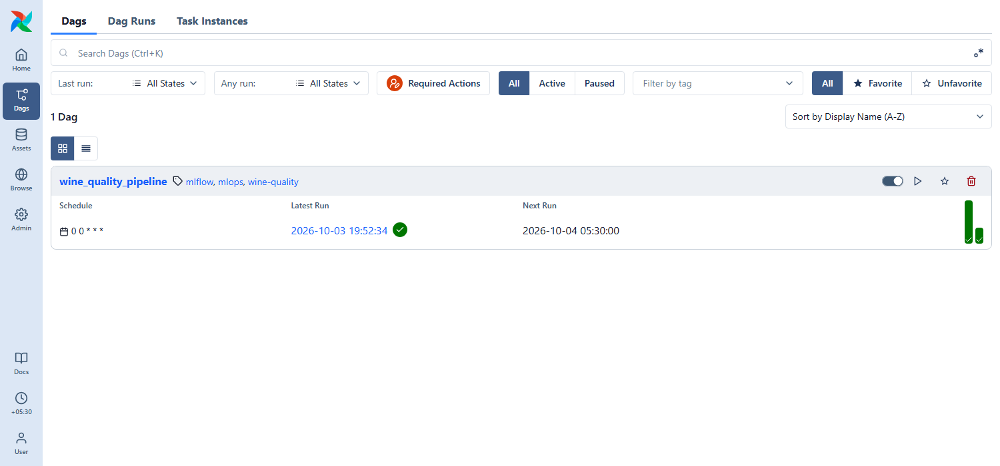
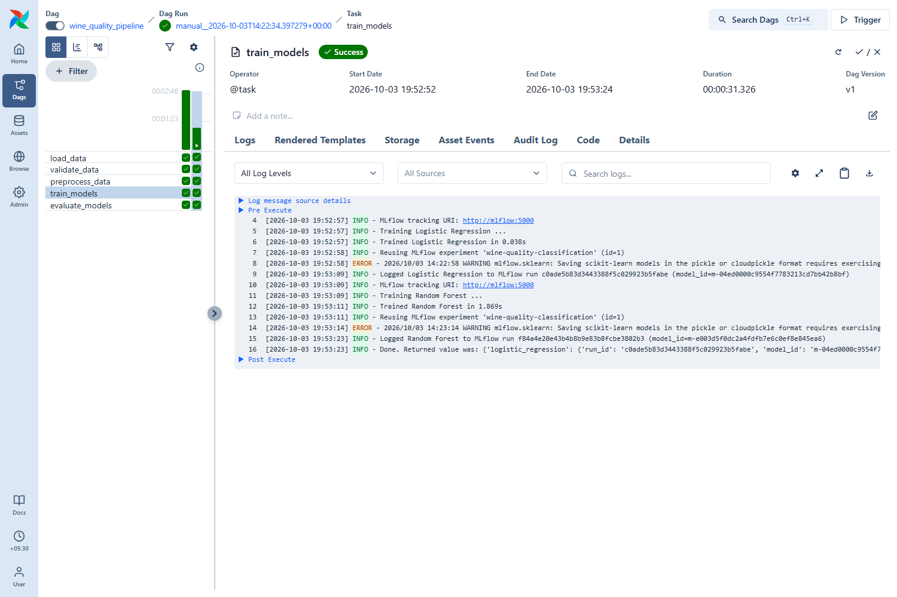
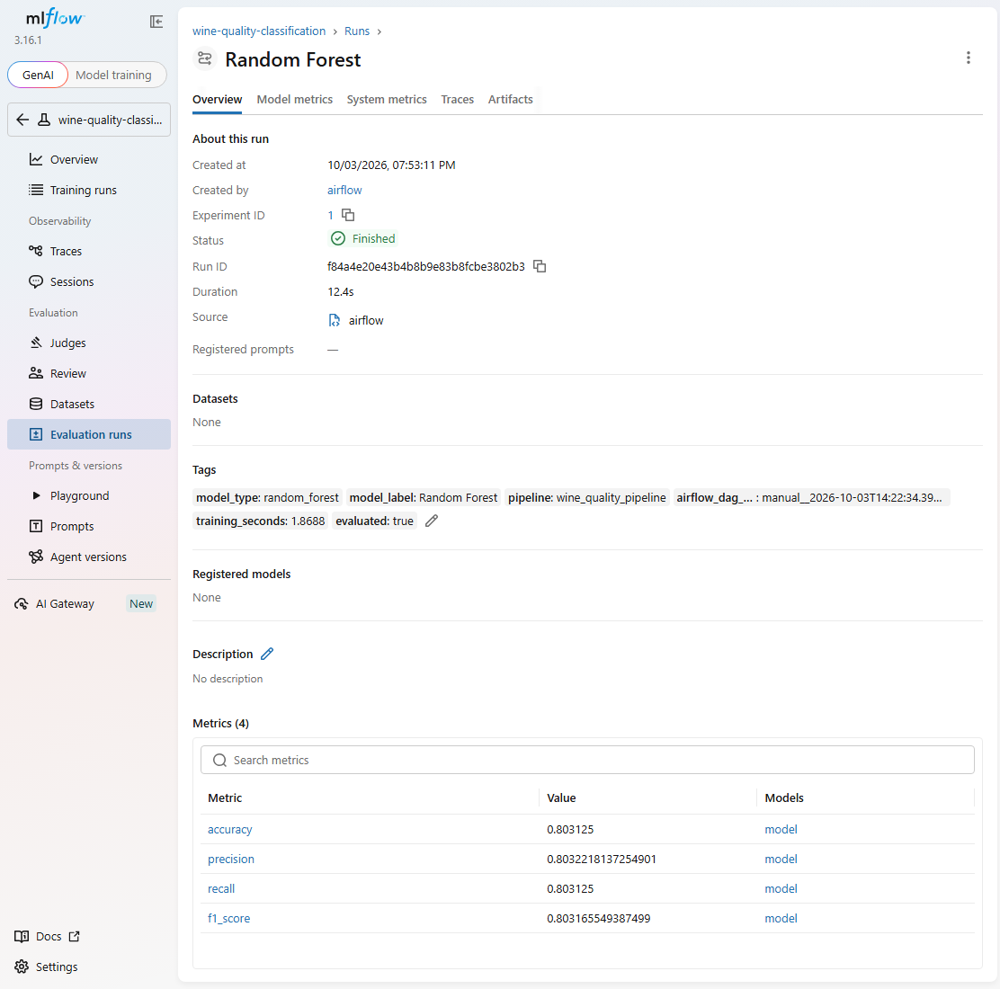
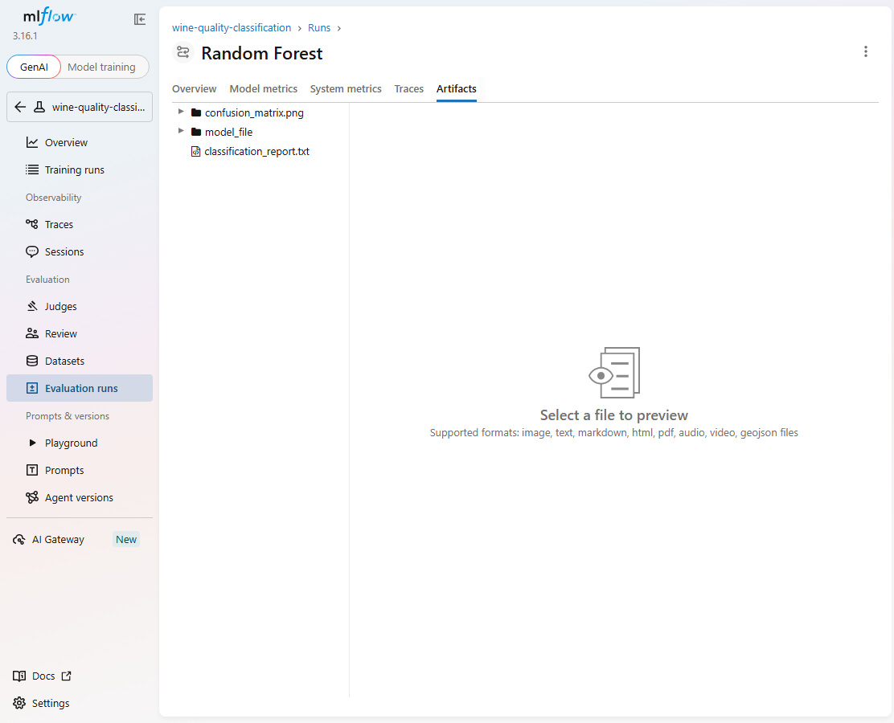

# Final Report - Wine Quality Classification with Apache Airflow and MLflow

Repository: <https://github.com/Ashwinth2004/wine-quality-mlops>

Everything in this report was run on Windows 11 with Docker Desktop. Airflow does not run natively on Windows, so Airflow
3.3.2 and the MLflow 3.16.1 server run in Docker containers started with `docker compose`.

## 1. Project summary

A binary classifier predicts whether a red wine is *good* (quality >= 6) from 11 chemical measurements. An Apache Airflow DAG
(`wine_quality_pipeline`) runs five tasks - load, validate, preprocess, train, evaluate. The `train_models` and `evaluate_models`
tasks log two scikit-learn models (Logistic Regression, Random Forest) to MLflow: parameters, metrics, a confusion matrix, a
classification report and the trained model. The DAG was run twice (one scheduled, one manual) and both runs succeeded.

## 2. Architecture

```
                 AIRFLOW  (DAG wine_quality_pipeline, @daily, UI :8080)
   load_data -> validate_data -> preprocess_data -> train_models -> evaluate_models
                                                        |                |
                                          +-------------+------+         |
                                          v                    v         |
                                Logistic Regression     Random Forest    |
                                          +---------+----------+         |
                                                    v                    v
                              MLFLOW tracking server (UI :5000)  <-- metrics + artifacts
                              experiment: wine-quality-classification
```

Airflow = orchestration. MLflow = experiment tracking. scikit-learn = machine learning. The DAG contains no ML code; it calls
functions in `src/pipeline.py`.

## 3. Final folder structure

```
dags/wine_quality_pipeline.py     src/{config,data,preprocess,train,evaluate,pipeline,tracking}.py
scripts/download_data.py          tests/test_pipeline.py
data/ (red + white wine CSV)      models/ artifacts/ (generated, git-ignored)
docker/Dockerfile                 docker-compose.yml
docs/screenshots/ (7 images)      README.md  FINAL_REPORT.md
requirements.txt  .env.example  .gitignore  .dockerignore
```

## 4. Important files

* `dags/wine_quality_pipeline.py` - the DAG (5 tasks, `@daily`, 1 retry, `max_active_runs=1`).
* `src/data.py` - loading and validation; every failure raises `WineDataError`.
* `src/preprocess.py` - binary target, stratified split, scikit-learn `Pipeline`s (no leakage).
* `src/train.py` / `src/evaluate.py` - training with MLflow params and model; metrics, plots and report.
* `src/config.py` - all settings in one place, overridable with environment variables.
* `docker-compose.yml` + `docker/Dockerfile` - run Airflow and MLflow on Windows.

## 5. Dataset

UCI Wine Quality, red wine (<https://archive.ics.uci.edu/dataset/186/wine+quality>): 1599 rows x 12 columns, 11 float features +
integer `quality`, 0 missing values. `quality` counts: 3:10, 4:53, 5:681, 6:638, 7:199, 8:18. Target `quality >= 6` -> good gives
53.5% good / 46.5% not_good (threshold 7 would give only 13.6% positives). The original `quality` column is never changed.

## 6. Models

| Model | Settings |
|---|---|
| Logistic Regression (with `StandardScaler`) | `C=1.0`, `max_iter=1000`, `random_state=42` |
| Random Forest | `n_estimators=300`, `max_depth=10`, `random_state=42` |

Stratified 80/20 split (1279 train / 320 test), `random_state=42`. Median imputer and scaler are fitted inside the `Pipeline`, on
training data only.

## 7. Metrics

`accuracy`, `precision`, `recall`, `f1_score` on the 320-row test set; precision/recall/F1 use `average="weighted"` because the
classes are almost balanced. A confusion matrix and a per-class classification report are logged as artifacts.

## 8. MLflow experiment name

`wine-quality-classification`

## 9. MLflow startup command

With Docker (used for all results): `docker compose up -d` (the server is defined in `docker-compose.yml` as
`mlflow server --host=0.0.0.0 --port=5000 --backend-store-uri=sqlite:////mlflow/mlflow.db --artifacts-destination=/mlflow/artifacts --serve-artifacts`).
Local alternative: `python -m mlflow server --backend-store-uri sqlite:///mlflow.db --default-artifact-root ./mlartifacts --host 127.0.0.1 --port 5000`.

## 10. Airflow startup commands

```powershell
docker compose up --build -d      # starts Airflow (runs `airflow standalone`) and MLflow
docker compose down               # stop
```

## 11. Airflow UI URL

<http://localhost:8080> - user `admin`; the password is generated at start-up:
`docker compose exec airflow cat /opt/airflow/simple_auth_passwords.json`

## 12. MLflow UI URL

<http://localhost:5000>

## 13. How to trigger the pipeline

Airflow UI -> **Dags** -> `wine_quality_pipeline` -> **Trigger**; then open the run and click a task -> **Logs**. Or:
`docker compose exec airflow airflow dags trigger wine_quality_pipeline`. The DAG also runs by itself once per day.

## 14. What is tracked in MLflow

* **Parameters:** `model_type`, `C`/`max_iter` or `n_estimators`/`max_depth`, `random_state`, `quality_threshold`, `test_size`,
  `n_features`, `feature_scaling`, `target_column`, `binary_target_column`.
* **Metrics:** `accuracy`, `precision`, `recall`, `f1_score`.
* **Artifacts:** `confusion_matrix.png`, `classification_report.txt`, `model_file/<model>.joblib`.
* **Model:** the full scikit-learn pipeline, logged with `mlflow.sklearn.log_model` (signature and input example).
* **Tags:** `airflow_dag_run_id`, `model_type`, `model_label`, `pipeline`, `training_seconds`, `evaluated`.

## 15. Actual experiment results

Four runs (two Airflow runs x two models), read from the MLflow server:

| Model | Airflow run | Accuracy | Precision | Recall | F1 |
|---|---|---|---|---|---|
| Logistic Regression | scheduled | 0.7406 | 0.7419 | 0.7406 | 0.7409 |
| Random Forest | scheduled | 0.8031 | 0.8032 | 0.8031 | 0.8032 |
| Logistic Regression | manual | 0.7406 | 0.7419 | 0.7406 | 0.7409 |
| Random Forest | manual | 0.8031 | 0.8032 | 0.8031 | 0.8032 |

Scores repeat exactly because the seed and split are fixed. Random Forest scored higher on this one split with untuned
settings; that is a comparison of these two runs, not a general claim.

Airflow task states for the manual run (all `success`): `load_data` 5.3 s, `validate_data` 4.9 s, `preprocess_data` 4.6 s,
`train_models` 31.3 s, `evaluate_models` 10.5 s.

## 16. Test results

* Local (Windows): `13 passed, 1 skipped` - the skipped test is the DAG import test, which needs Airflow.
* Inside the Airflow container: `14 passed` (includes the DAG import and structure test).
* Failure check: with `WINE_QUALITY_CSV` pointing at a missing file, `load_data` raised `WineDataError` and Airflow logged
  "Task failed with exception".

## 17. Problems encountered and fixes

| Problem | Fix |
|---|---|
| Airflow cannot be imported on Windows (`os.register_at_fork` missing) | Run Airflow in Docker Desktop |
| Docker: "Virtualization support not detected" | BIOS was fine; needed a real Windows **Restart** and `bcdedit /set hypervisorlaunchtype auto` (elevated) |
| MLflow container exited at start; `train_models` could not resolve host `mlflow` | Airflow image entrypoint treated `mlflow server` as an Airflow command; set `entrypoint: ["mlflow","server"]` and made `/mlflow` writable |
| DAG test failed on Airflow 3.3 (`DagBag` has no `include_examples`) | Updated the test to the Airflow 3 `DagBag` signature |
| `UnicodeEncodeError` ending MLflow runs on Windows | `src/config.py` disables the emoji URL banner |
| PowerShell quoting broke the git commit message and an MLflow compare URL | Used a message file and URL-encoded the URL |

## 18. Remaining limitations

* Red-wine data only; no cross-validation or hyperparameter tuning, so the model comparison rests on a single split.
* In the Airflow task log, a scikit-learn pickle *warning* printed by MLflow appears with the label `ERROR` because it is written
  to stderr; it is a warning, not a failure (the task succeeded).
* Local setup only: the Airflow admin password is generated at start-up and nothing is hardened for production.
* Local-venv runs and Docker runs use separate MLflow databases.
* Airflow run times shown in the UI use the browser's time zone (+05:30), MLflow shows its own local time.

## 19. Suggested next improvements

MLflow Model Registry with automated model promotion, CI/CD (run the tests on each push), cloud deployment, model and data
monitoring, hyperparameter tuning and cross-validation, using the white-wine data as well.

## Screenshots (taken from the running system)

**Airflow - DAG list** (`wine_quality_pipeline`, daily schedule, latest run succeeded)


**Airflow - manual run, all 5 tasks succeeded**


**Airflow - `train_models` task log (MLflow tracking URI, both models logged)**


**MLflow - experiment `wine-quality-classification` with the four runs created by Airflow**


**MLflow - Random Forest run: tags and the four metrics**


**MLflow - run artifacts (`confusion_matrix.png`, `classification_report.txt`, `model_file`)**


**MLflow - comparing Logistic Regression and Random Forest**

