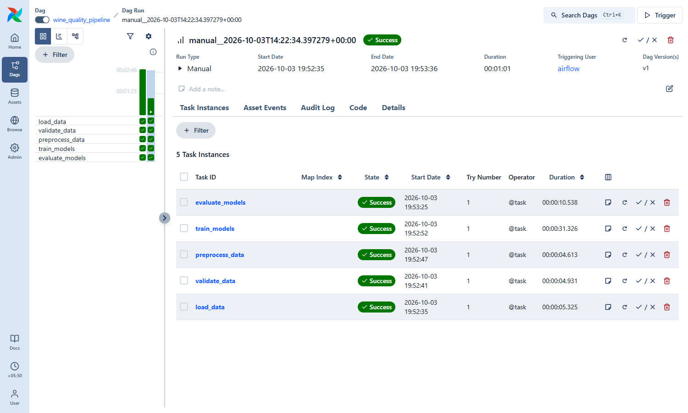
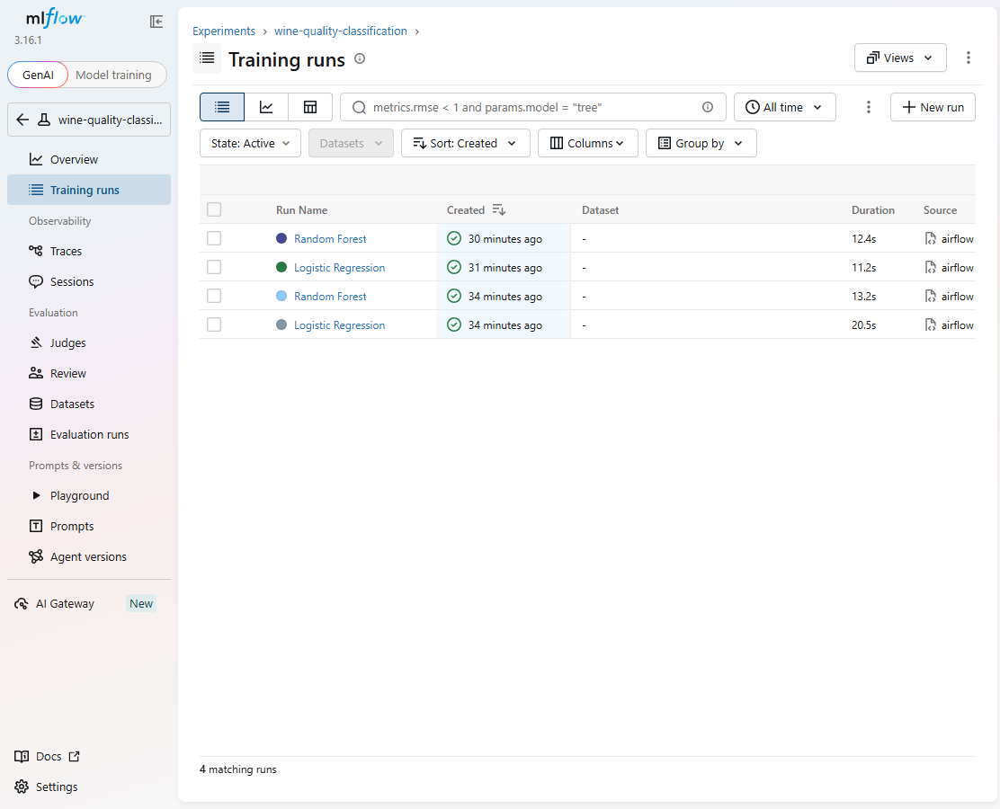
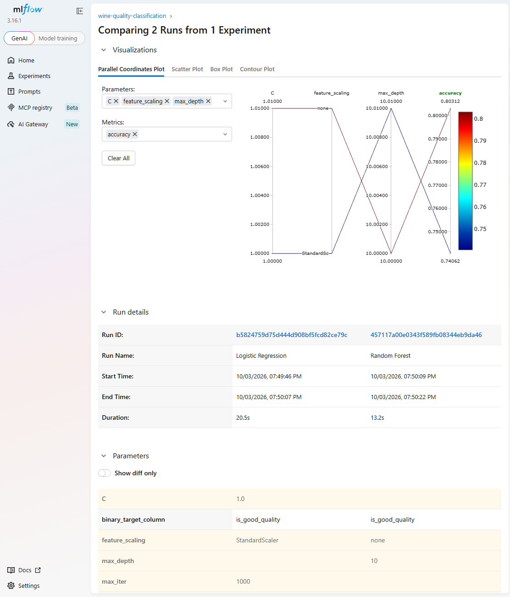

# Wine Quality Classification with Apache Airflow and MLflow

## Overview

A small, fully local MLOps project. It predicts whether a red wine is **good** (quality >= 6) from 11 physicochemical
measurements, using two scikit-learn models. **Apache Airflow orchestrates the workflow** (load -> validate -> preprocess ->
train -> evaluate) and **MLflow tracks every experiment** (parameters, metrics, artifacts, logged models).

## Objective

Show how the two tools complement each other:

* Airflow answers *"did the pipeline run, in what order, when, and did each step succeed?"* (scheduling, dependencies, retries, logs).
* MLflow answers *"which model, with which parameters, produced which metrics?"* (runs, comparison, model storage).

> **Verification status.** Everything below was run on Windows 11. Airflow does not run natively on Windows, so Airflow
> 3.3.2 and the MLflow server run in Docker Desktop containers (the host stays Windows). The DAG was executed twice (one
> scheduled, one manual): all 5 tasks succeeded both times and 4 MLflow runs were recorded. 14/14 tests pass inside the
> container; 13 pass and 1 (the DAG test, which needs Airflow) is skipped on native Windows.

## Dataset

UCI **Wine Quality**, red wine: <https://archive.ics.uci.edu/dataset/186/wine+quality>. Stored in `data/winequality-red.csv`
(semicolon separated). `python -m scripts.download_data` downloads it again from the UCI repository.

Findings from inspecting the actual file:

| Property | Value |
|---|---|
| Rows x columns | 1599 x 12 |
| Types | 11 float64 features, `quality` int64 |
| Missing values | 0 |
| `quality` counts | 3: 10, 4: 53, 5: 681, 6: 638, 7: 199, 8: 18 |

Feature statistics (mean / std / min / max):

| Feature | Mean | Std | Min | Max |
|---|---|---|---|---|
| fixed acidity | 8.32 | 1.74 | 4.60 | 15.90 |
| volatile acidity | 0.53 | 0.18 | 0.12 | 1.58 |
| citric acid | 0.27 | 0.19 | 0.00 | 1.00 |
| residual sugar | 2.54 | 1.41 | 0.90 | 15.50 |
| chlorides | 0.09 | 0.05 | 0.01 | 0.61 |
| free sulfur dioxide | 15.87 | 10.46 | 1.00 | 72.00 |
| total sulfur dioxide | 46.47 | 32.90 | 6.00 | 289.00 |
| density | 1.00 | 0.00 | 0.99 | 1.00 |
| pH | 3.31 | 0.15 | 2.74 | 4.01 |
| sulphates | 0.66 | 0.17 | 0.33 | 2.00 |
| alcohol | 10.42 | 1.07 | 8.40 | 14.90 |

**Binary target:** `quality >= 6` -> `good` (1), otherwise `not_good` (0). Threshold 6 gives **53.5% good / 46.5% not_good**
(almost balanced). Threshold 7 would give only 13.6% positives, so 6 was chosen. Change it with `WINE_QUALITY_THRESHOLD`; the
original `quality` column is never modified.

## Architecture

```
                 AIRFLOW  (DAG wine_quality_pipeline, @daily, UI :8080)
   load_data -> validate_data -> preprocess_data -> train_models -> evaluate_models
                                                        |                |
                                          +-------------+------+         |
                                          v                    v         |
                                Logistic Regression     Random Forest    |
                                          |                    |         |
                                          +---------+----------+         |
                                                    v                    v
                              MLFLOW tracking server (UI :5000)  <-- metrics + artifacts
                              experiment: wine-quality-classification
                              per run: parameters | metrics | confusion_matrix.png |
                                       classification_report.txt | logged model
```

| Tool | Responsibility |
|---|---|
| Airflow | workflow orchestration, task dependencies, scheduling, retries (1), task status and logs |
| MLflow | experiment tracking, runs, parameters, metrics, artifacts, model logging |
| scikit-learn | preprocessing, training, prediction, evaluation |

## Technologies

Python 3.12, pandas, NumPy, scikit-learn, matplotlib, Apache Airflow 3.3.2, MLflow 3.16.1, pytest, Docker Compose.

## Project structure

```
dags/wine_quality_pipeline.py   thin DAG: only wires task dependencies and calls src.pipeline
src/config.py                   all settings (env-overridable, project-relative paths)
src/data.py                     dataset loading + validation (raises WineDataError)
src/preprocess.py               binary target, stratified split, scikit-learn pipelines
src/train.py                    fits both models, one MLflow run each, logs params + model
src/evaluate.py                 metrics, confusion matrix, report; logged into the same runs
src/pipeline.py                 task entry points used by the DAG (also a CLI: python -m src.pipeline all)
src/tracking.py                 MLflow setup helpers
scripts/download_data.py        fetch the dataset from UCI
tests/test_pipeline.py          pytest suite
data/  models/  artifacts/      dataset, saved models, plots and reports (artifacts/models are git-ignored)
docker/Dockerfile               one image (Airflow + ML libraries + MLflow) for both services
docker-compose.yml              mlflow service (:5000) + airflow service (:8080)
requirements.txt  .env.example  .gitignore  .dockerignore
```

## Preprocessing and models

Load -> validate -> create binary target -> stratified 80/20 split (`random_state=42`) -> per-model scikit-learn `Pipeline`.
The median imputer and the `StandardScaler` (Logistic Regression only) live inside the `Pipeline`, so they are fitted on the
training data only (no leakage; a test asserts this).

| Model | Parameters logged |
|---|---|
| Logistic Regression (scaled) | `model_type`, `C=1.0`, `max_iter=1000`, `random_state=42` |
| Random Forest | `model_type`, `n_estimators=300`, `max_depth=10`, `random_state=42` |

Both runs also log `quality_threshold`, `test_size`, `n_features`, `feature_scaling`.

## Evaluation metrics

All metrics are computed on the held-out **test set** (320 rows) and logged as `accuracy`, `precision`, `recall`, `f1_score`.

* **Accuracy** - share of wines classified correctly.
* **Precision** - of the wines predicted in a class, the share that truly belong to it.
* **Recall** - of the wines truly in a class, the share the model found.
* **F1-score** - harmonic mean of precision and recall.

Precision, recall and F1 use `average="weighted"` (per-class scores weighted by class size). The classes are almost balanced,
so this gives one representative number without hiding a weak class; the per-class breakdown is in `classification_report.txt`.

## Run with Docker (Windows, recommended)

Needs Docker Desktop with the engine running.

```powershell
docker compose up --build -d     # first build takes a few minutes
```

| UI | URL | Login |
|---|---|---|
| Airflow | <http://localhost:8080> | user `admin`; password: `docker compose exec airflow cat /opt/airflow/simple_auth_passwords.json` |
| MLflow | <http://localhost:5000> | none |

Inside Docker, the Airflow tasks reach MLflow at `http://mlflow:5000` (`MLFLOW_TRACKING_URI` in `docker-compose.yml`); the browser
sees the same server at `localhost:5000`. The MLflow server's start command is defined in `docker-compose.yml`
(`mlflow server --host=0.0.0.0 --port=5000 --backend-store-uri=sqlite:////mlflow/mlflow.db --serve-artifacts ...`).

### Trigger the pipeline

The DAG is unpaused when created and scheduled `@daily`, so Airflow also starts a run by itself. To run it manually:

* UI: **Dags** -> `wine_quality_pipeline` -> **Trigger** -> open the run to see the 5 tasks -> click a task -> **Logs**.
* CLI:

```powershell
docker compose exec airflow airflow dags trigger wine_quality_pipeline
docker compose exec airflow airflow dags list-runs wine_quality_pipeline
docker compose exec airflow airflow tasks states-for-dag-run wine_quality_pipeline <run_id>
```

`max_active_runs=1`, so a manual trigger queues behind a run that is still going. Stop everything with `docker compose down`
(add `-v` to also delete the MLflow/Airflow data volumes).

## Run without Airflow (local venv, optional)

```powershell
python -m venv .venv ; .\.venv\Scripts\Activate.ps1
pip install -r requirements.txt ; copy .env.example .env
python -m mlflow server --backend-store-uri sqlite:///mlflow.db --default-artifact-root ./mlartifacts --host 127.0.0.1 --port 5000
python -m src.pipeline all      # or one step: load_data | validate_data | preprocess_data | train_models | evaluate_models
```

This uses its own `mlflow.db`, separate from the Docker MLflow data.

## MLflow tracking

In the MLflow UI open experiment **`wine-quality-classification`**. Every pipeline run adds two *runs* (named "Logistic
Regression" and "Random Forest"); runs from Airflow carry the tag `airflow_dag_run_id`.

* **Parameters** - model hyper-parameters plus threshold / split / scaling info.
* **Metrics** - `accuracy`, `precision`, `recall`, `f1_score` (test set).
* **Artifacts** - `confusion_matrix.png`, `classification_report.txt`, `model_file/<name>.joblib`.
* **Model** - the full scikit-learn pipeline logged with `mlflow.sklearn.log_model` (signature + input example), listed under
  the run's "Logged models".
* **Compare** - tick several runs and click *Compare*, or switch the runs table to the chart view.

## Results (actual Airflow runs)

Two DAG runs (one scheduled, one manual) produced four MLflow runs; the values below are read from the MLflow server
(`mlflow.search_runs`), not typed in:

| Model | Airflow run | Accuracy | Precision | Recall | F1 |
|---|---|---|---|---|---|
| Logistic Regression | scheduled | 0.7406 | 0.7419 | 0.7406 | 0.7409 |
| Random Forest | scheduled | 0.8031 | 0.8032 | 0.8031 | 0.8032 |
| Logistic Regression | manual | 0.7406 | 0.7419 | 0.7406 | 0.7409 |
| Random Forest | manual | 0.8031 | 0.8032 | 0.8031 | 0.8032 |

Repeated runs give identical scores because the seed and split are fixed. On this single split and these fixed settings, Random
Forest scored higher than Logistic Regression; no tuning or cross-validation was done, so this is a comparison of these two runs,
not a general claim.

### Screenshots

Taken from the running system (full set with captions in [FINAL_REPORT.md](FINAL_REPORT.md)):





The complete 19-point report (architecture, results, tests, problems and fixes, limitations) is in
[FINAL_REPORT.md](FINAL_REPORT.md).

## Tests

```powershell
python -m pytest tests -q        # local: 13 passed, 1 skipped (DAG test needs Airflow, unavailable on native Windows)
docker compose exec airflow python -m pytest /opt/project/tests -q    # in the container: 14 passed
```

Covers: dataset loading and columns, validation failures (empty, missing column, NaN, non-numeric), binary target, stratified
split, no-leakage scaler fit, both models training and predicting, metric ranges, confusion-matrix plot, an MLflow logging test
on an isolated SQLite backend, and the DAG import/structure test. If `pytest` is missing in the container, run
`docker compose exec airflow pip install pytest` first.

Failure behaviour was also checked: pointing `WINE_QUALITY_CSV` at a missing file makes the `load_data` task raise
`WineDataError` and Airflow reports `Task failed with exception`.

## Troubleshooting (issues actually hit)

* **Airflow cannot run on native Windows** (`os.register_at_fork` is missing). Fixed by running Airflow in Docker Desktop.
* **Docker Desktop: "Virtualization support not detected"** after `wsl --install`. The BIOS setting was already on; Windows needed a
  real **Restart** (not Shut down) plus `bcdedit /set hypervisorlaunchtype auto` from an *elevated* PowerShell.
* **`docker` not found in an already-open terminal**: open a new terminal (PATH is refreshed) or add
  `...\DockerDesktop\resources\bin` to PATH.
* **MLflow container exited immediately** and `train_models` failed with `Failed to resolve 'mlflow'`: the Airflow image's
  entrypoint treats `mlflow server` as an Airflow command. Fixed with `entrypoint: ["mlflow", "server"]` and a writable `/mlflow`
  directory in `docker/Dockerfile`.
* **DAG test failed in Airflow 3.3** (`DagBag() got an unexpected keyword argument 'include_examples'`): the test now uses the
  Airflow 3 `DagBag(dag_folder, bundle_path, bundle_name)` signature.
* **`UnicodeEncodeError` at the end of an MLflow run on Windows**: MLflow prints an emoji URL banner; `src/config.py` disables it.
* **`log_text` vs `log_artifact`**: `log_text` takes content, `log_artifact` takes a file path (handled in `evaluate.py`).
* **pickle warning from `mlflow.sklearn`**: expected; models are saved with `serialization_format="pickle"`.
* **Slow first task**: files are read through the Windows bind mount, so the first tasks take about a minute.

## Limitations

* Only the red-wine file is used; no hyperparameter tuning or cross-validation.
* The Airflow login password is generated at start-up and the setup is for local use only (no authentication hardening).
* Local venv runs and Docker runs use separate MLflow databases.

## Future improvements

MLflow Model Registry and automated model promotion, CI/CD, cloud deployment, model monitoring, hyperparameter tuning.
